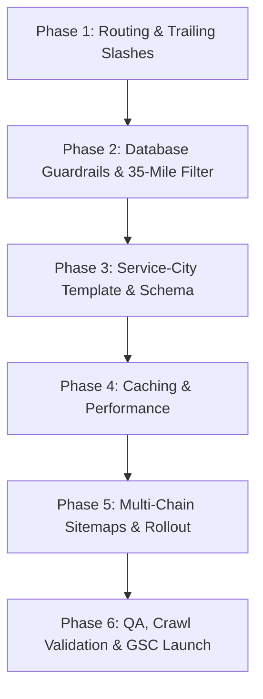

# Technical Architecture Plan: Nationwide Programmatic SEO (pSEO) v2.0
**Project**: Certified Drug Test Centers (`certifieddrugtestingcenters.com`)  
**Deployment Target**: Chain 1 (41,000+ City & State Pages) & Multi-Chain Scaling  
**Document Version**: 2.0 • November 2026  
**File Location**: `pSEO_plan.md`

---

## 1. Executive Summary & Objectives

This implementation plan translates the **Technical Architecture Directive Version 2.0** into an actionable, file-by-file engineering roadmap for `certifieddrugtestingcenters.com`. 

Previous programmatic rollouts suffered from over 300,000 crawl errors in Google Search Console (GSC) caused by:
1. Routing conflicts between server rewrites and framework slug generators (trailing slash bounces).
2. Soft 404s and doorway detection triggered by empty pages and redirects back to parent state hubs.
3. Thin content de-indexing due to lack of distinct local facility data, compliance notes, and rich schema markup.
4. Crawl budget exhaustion resulting from bulk sitemap drops without progressive staging.

### Core Targets
- **Zero Redirect Loops & Zero Internal 301s**: Hard-code strict trailing slash normalization.
- **Strict 4-Tier Hierarchy**: `https://certifieddrugtestingcenters.com/services/{service-slug}/{state-slug}/{city-slug}/`.
- **Doorway Prevention (35-Mile Guardrail)**: Suppress generation and return 404 for any city lacking at least 1 active collection center within 35 miles (no generic state fallbacks).
- **Sub-200ms Time-to-First-Byte (TTFB)**: Compound indexing and high-concurrency page caching.
- **Structured Sitemaps**: 50,000-URL segmented chain sitemaps launched on a strict 5-day rolling protocol.

---

## 2. URL Architecture & Normalization Matrix

### 2.1 The 4-Tier Routing Hierarchy
The URL architecture must enforce the following pattern:
```
https://certifieddrugtestingcenters.com/services/{service-slug}/{state-slug}/{city-slug}/
```

#### Example Valid URLs:
- `https://certifieddrugtestingcenters.com/services/5-panel-drug-test/florida/orlando/`
- `https://certifieddrugtestingcenters.com/services/10-panel-drug-test/texas/houston/`
- `https://certifieddrugtestingcenters.com/services/dot-drug-test/california/los-angeles/`

#### Service Chain Definitions (9 Core Chains):
1. `5-panel-drug-test` (Chain 1 - Active Launch Target)
2. `10-panel-drug-test`
3. `12-panel-drug-test`
4. `dot-drug-test`
5. `hair-follicle-drug-test`
6. `breath-alcohol-test`
7. `instant-drug-test`
8. `court-ordered-drug-test`
9. `random-drug-testing`

### 2.2 Strict Trailing Slash Normalization Middleware
To eliminate internal 301 redirect loops between Nginx and Laravel:
- **Middleware**: Create `App\Http\Middleware\EnforceTrailingSlash.php`.
- **Rule**: If the incoming request path for programmatic routes (`/services/*`) does not end with `/`, issue a single permanent `301 Moved Permanently` redirect to the exact URL with a trailing slash (preserving query parameters if present).
- **URL Generator / Route Helpers**: Ensure all generated internal links (`route('services.city', [...])`, Blade links, canonical links) explicitly append the trailing slash by default.
- **Nginx / Apache Configuration**: Verify `.htaccess` or Nginx blocks do not rewrite `/services/.../` to non-slash, eliminating server-framework conflicts.

### 2.3 ASCII Slug Transliterator
Create `App\Services\SlugTransliterator.php`:
- Strip diacritics and macrons (e.g., Hawaii’s `Hālawa` → `halawa`).
- Completely remove apostrophes, accents, and quotes (e.g., `O'Fallon` → `ofallon`, `Lee's Summit` → `lees-summit`).
- Convert special punctuation (`&`, `/`, `+`) to standard dashes or omit.
- Remove duplicate dashes and trim leading/trailing hyphens.
- Ensure only lowercase alphanumeric characters `[a-z0-9-]` exist in `{service-slug}`, `{state-slug}`, and `{city-slug}`.

### 2.4 Absolute Self-Referencing Canonical Tags
The `<head>` section must output an exact, self-referencing canonical tag matching the requested scheme, domain, path, and trailing slash:
```html
<link rel="canonical" href="https://certifieddrugtestingcenters.com/services/5-panel-drug-test/florida/orlando/" />
```

---

## 3. Database Guardrails & Spatial Radius Filtering

### 3.1 35-Mile Haversine Radius Guardrail (Eliminate Soft 404s)
**Previous Flawed Logic**: When a city had no direct facility match, the controller queried 6 random facilities in the same state, rendering misleading local data and triggering Google doorway penalties.

**Required Implementation**:
1. Every programmatic city node must be evaluated against the `locations` table using the Haversine formula based on `cities.lat`, `cities.lng` and `locations.lat`, `locations.lng`:
   ```sql
   SELECT id, name, address1, city, state, zip, hours, lat, lng,
          (3959 * acos(cos(radians(?)) * cos(radians(lat)) * cos(radians(lng) - radians(?)) + sin(radians(?)) * sin(radians(lat)))) AS distance
   FROM locations
   WHERE is_active = 1
   HAVING distance <= 35
   ORDER BY distance ASC
   LIMIT 10;
   ```
2. **Hard Gate**: If a municipality has **0 active centers within 35 miles**, the page builder/controller **must abort with 404** (or be suppressed entirely from generation and sitemaps). Never bounce to the state hub via 301 and never display "No clinics found".

### 3.2 Unincorporated Towns & Thin Census Localities
- Pre-generate an eligible index table (`pseo_eligible_cities`) or cache key storing only cities that meet the ≥ 1 active center within 35 miles threshold.
- Suppress unincorporated census areas lacking physical or mobile collection coverage.

### 3.3 Retired Locations Table & HTTP 410 Gone Handler
Create a migration and model for legacy/retired URLs:
- Table: `retired_routes` (`id`, `legacy_url`, `action` ['410', '301'], `target_url`, `created_at`).
- If an incoming request hits a permanently purged clinic or legacy URL, return **`HTTP 410 Gone`** with a clean header:
  ```php
  return response()->view('errors.410', [], 410);
  ```
- If an active nearby hub exists, execute a direct 301 to that exact city URL (with trailing slash).

---

## 4. On-Page Dynamic Content & Structured Data (JSON-LD)

To prevent Google’s *"Crawled - currently not indexed"* classification, each city page must dynamically assemble unique local data points:

### 4.1 Nearest Center Cards
Display actual facilities with:
- Facility Name & Lab Network badge (`Quest Diagnostics Certified Partner`, `Labcorp Partner`).
- Full Physical Address (`address1`, `city`, `state`, `zip`).
- Exact Distance from city centroid: `2.4 miles away` (calculated dynamically).
- Real-time Operating Hours & Today's Status (`Open Today: 8:00 AM - 5:00 PM`).
- Walk-In vs. Appointment Status badge (`Walk-Ins Welcome Today - Electronic Donor Pass Required`).
- Turn-by-turn navigation links (Google Maps, Apple Maps, Waze).

### 4.2 State Compliance Module
Dynamically pull statutory drug-testing regulations from the `states` table (`statute_code`, `medical_marijuana_status`, `worker_comp_rules`, `employer_rights_summary`, `faqs_json`):
- Florida Drug-Free Workplace Program (F.S. 440.102) vs. California Lab Restrictions.
- Mandatory employer discount disclosures (Worker's Comp premium reduction rules).
- State-specific mandatory confirmation testing requirements (GC/MS or LC/MS).

### 4.3 Structured Data Specification (JSON-LD)
Every service-state-city page must output complete `MedicalBusiness` and `OfferCatalog` schema:

```json
{
  "@context": "https://schema.org",
  "@type": "MedicalBusiness",
  "name": "Certified Drug Testing Centers - Orlando, FL",
  "url": "https://certifieddrugtestingcenters.com/services/5-panel-drug-test/florida/orlando/",
  "telephone": "+1-800-985-4339",
  "priceRange": "$$",
  "medicalSpecialty": "SubstanceAbuseScreening",
  "address": {
    "@type": "PostalAddress",
    "streetAddress": "123 Main St",
    "addressLocality": "Orlando",
    "addressRegion": "FL",
    "postalCode": "32801",
    "addressCountry": "US"
  },
  "geo": {
    "@type": "GeoCoordinates",
    "latitude": 28.5383,
    "longitude": -81.3792
  },
  "hasOfferCatalog": {
    "@type": "OfferCatalog",
    "name": "5-Panel Drug Screening",
    "itemListElement": [
      {
        "@type": "Offer",
        "itemOffered": {
          "@type": "Service",
          "name": "5-Panel Urine Drug Test",
          "description": "SAMHSA-certified 5-panel laboratory screening detecting Marijuana (THC), Cocaine (COC), Basic Opiates (OPI), Amphetamines (AMP), and Phencyclidine (PCP)."
        }
      }
    ]
  }
}
```

---

## 5. Hub-and-Spoke Internal Crawl Architecture

Programmatic pages must never exist as dead-end orphan nodes. The template will implement two bidirectional linking pathways:

### 5.1 Breadcrumb Hierarchy & Schema.org BreadcrumbList
Render visual and machine-readable breadcrumb pathways:
`Home > Services > 5-Panel Drug Test > Florida > Orlando`

JSON-LD Markup:
```json
{
  "@context": "https://schema.org",
  "@type": "BreadcrumbList",
  "itemListElement": [
    { "@type": "ListItem", "position": 1, "name": "Home", "item": "https://certifieddrugtestingcenters.com/" },
    { "@type": "ListItem", "position": 2, "name": "Services", "item": "https://certifieddrugtestingcenters.com/services/" },
    { "@type": "ListItem", "position": 3, "name": "5-Panel Drug Test", "item": "https://certifieddrugtestingcenters.com/services/5-panel-drug-test/" },
    { "@type": "ListItem", "position": 4, "name": "Florida", "item": "https://certifieddrugtestingcenters.com/services/5-panel-drug-test/florida/" },
    { "@type": "ListItem", "position": 5, "name": "Orlando", "item": "https://certifieddrugtestingcenters.com/services/5-panel-drug-test/florida/orlando/" }
  ]
}
```

### 5.2 Cross-Service City Switcher
In the sidebar and footer of every city page, render a grid linking to the other 8 service chains in that identical city:
- *10-Panel Drug Test in Orlando, FL*
- *12-Panel Drug Test in Orlando, FL*
- *DOT Drug Screening & Physical in Orlando, FL*
- *Hair Follicle Drug Test in Orlando, FL*
- *Breath Alcohol Testing in Orlando, FL*
- *Rapid / Instant Drug Screen in Orlando, FL*
- *Court-Ordered Testing in Orlando, FL*
- *Random / Employer Accounts in Orlando, FL*

---

## 6. Sitemap Architecture & The 5-Day Rollout Protocol

### 6.1 Multi-Chain File Segmentation
Google enforces a hard limit of 50,000 URLs and 50MB uncompressed per sitemap file. The programmatic sitemap engine will split output into segmented chain files:

| Sitemap File | Scope | URL Volume | Scheduled Submission Gate |
| :--- | :--- | :--- | :--- |
| `sitemap-chain1.xml` | Chain 1: 5-Panel Urine Drug Test | ~41,300 URLs | **Day 1**: Screaming Frog crawl verification (≥98% 200 OK, 0 redirects, 0 404s) |
| `sitemap-chain2.xml` | Chain 2: 10-Panel Drug Test | ~41,300 URLs | **Day 5**: Response times in GSC stable (<300ms), 0 error spikes |
| `sitemap-chain3.xml` | Chain 3: DOT Testing | ~41,300 URLs | **Day 10**: Verify crawl budget stability |
| `sitemap-chain4.xml` | Chain 4: Hair Follicle | ~41,300 URLs | **Day 15**: Progressive crawl verification |
| `sitemap-chain5.xml` | Chain 5: Breath Alcohol | ~41,300 URLs | **Day 20**: Progressive crawl verification |
| `sitemap-chain6.xml` | Chain 6: 12-Panel Testing | ~41,300 URLs | **Day 25**: Progressive crawl verification |
| `sitemap-chain7.xml` | Chain 7: Rapid Testing | ~41,300 URLs | **Day 30**: Progressive crawl verification |
| `sitemap-chain8.xml` | Chain 8: Court Ordered | ~41,300 URLs | **Day 35**: Progressive crawl verification |
| `sitemap-chain9.xml` | Chain 9: Random / Employer | ~41,300 URLs | **Day 40**: Final chain deployment |
| `sitemap-index.xml` | Master Parent Index | Lists all 9 XMLs | **DO NOT SUBMIT ON DAY 1**. Submit only after all individual chains are indexed |

### 6.2 Pre-Submission Crawler Gate
An automated Artisan command (`php artisan pseo:validate-sitemap chain1`) will sample and verify:
1. **HTTP Status**: Must be `200 OK` (0 redirects, 0 404s).
2. **Trailing Slash**: Every `<loc>` entry must end with `/`.
3. **Response Latency**: Sample TTFB must remain <300ms.
4. **Canonical Consistency**: `<link rel="canonical">` matches `<loc>` exactly.

> [!WARNING]
> **Critical Search Console Instruction**: Do NOT click "Validate Fix" in Google Search Console immediately upon uploading. Allow Googlebot 48 to 72 hours of uninterrupted sampling. Triggering validation early causes immediate premature rejection.

---

## 7. Performance, Caching & Database Indexing

Serving 41,000+ programmatic nodes under Googlebot crawl rates of 30,000+ hits/day requires sub-200ms TTFB:

### 7.1 Database Indexing Migration
Create a migration to add composite and spatial indexes:
```php
Schema::table('cities', function (Blueprint $table) {
    $table->index(['state_id', 'is_active', 'slug'], 'idx_cities_state_active_slug');
    $table->index(['lat', 'lng'], 'idx_cities_coordinates');
});

Schema::table('locations', function (Blueprint $table) {
    $table->index(['is_active', 'state'], 'idx_locations_active_state');
    $table->index(['lat', 'lng'], 'idx_locations_coordinates');
});
```

### 7.2 Full-Page Response Caching Middleware
Implement high-speed page caching (`App\Http\Middleware\PseoPageCache.php`):
- Cache key: `pseo_page:` . md5($request->getRequestUri()).
- Storage: Redis or high-performance file store.
- TTL: 7 days.
- Bypassed for authenticated admin sessions or POST requests.
- Returns `X-Cache: HIT` header with <100ms response times.

---

## 8. Detailed Implementation Phases & File Changes



### Phase 1: Routing, Trailing Slashes & Slugs (4 – 5 Hours)
1. Create `app/Http/Middleware/EnforceTrailingSlash.php` and register in `bootstrap/app.php` or `app/Http/Kernel.php`.
2. Create `app/Services/SlugTransliterator.php` for ASCII clean slug generation.
3. Define new 4-tier routes in `routes/web.php`:
   - `GET /services/{service_slug}/{state_slug}/{city_slug}/` → `PseoServiceController@city`
   - `GET /services/{service_slug}/{state_slug}/` → `PseoServiceController@state`
   - `GET /services/{service_slug}/` → `PseoServiceController@service`
4. Update `resources/views/layouts/main.blade.php` to guarantee canonical tag always includes full protocol, domain, path, and trailing slash.

### Phase 2: Database Guardrails & Spatial Filter (4 – 5 Hours)
1. Create migration `create_pseo_eligible_cities_and_retired_routes_tables.php`.
2. Implement spatial Haversine distance calculator in `app/Services/GeoLocationService.php`.
3. Build `app/Console/Commands/ComputeEligiblePseoCities.php` to pre-calculate and cache which cities have ≥ 1 active center within 35 miles.
4. Enforce strict 404 handling in `PseoServiceController` if an requested city lacks local center coverage.
5. Implement `App\Http\Middleware\RetiredRouteMiddleware.php` to serve HTTP 410 for retired paths.

### Phase 3: Service-City Template, Compliance & JSON-LD (5 – 6 Hours)
1. Create controller `app/Http/Controllers/PseoServiceController.php`.
2. Create view `resources/views/services/city.blade.php`:
   - Nearest collection site cards with exact calculated mileage (`2.4 miles away`).
   - Integrated State Compliance & Legal Framework module (from `states` table).
   - Dynamic 3-step walk-in guide for the specific test type.
   - Cross-Service City Switcher linking all 9 chains for that city.
   - Breadcrumbs with `BreadcrumbList` schema.
   - `MedicalBusiness` + `OfferCatalog` + `Service` JSON-LD structured data.

### Phase 4: Performance Caching & DB Indexing (3 – 4 Hours)
1. Create migration `add_pseo_performance_indexes.php`.
2. Implement `app/Http/Middleware/PseoPageCache.php` with Redis/file driver.
3. Add cache warming command: `php artisan pseo:warm-cache {chain}`.
4. Verify sub-200ms TTFB across sampled endpoints.

### Phase 5: Multi-Chain Sitemap Generation & Rollout Scripts (4 – 6 Hours)
1. Create `app/Http/Controllers/PseoSitemapController.php`:
   - Route `/sitemap-chain{id}.xml` (id from 1 to 9).
   - Route `/sitemap-index.xml`.
2. Generate compliant XML with `<lastmod>`, `<changefreq>weekly</changefreq>`, `<priority>0.8</priority>`.
3. Create pre-submission audit command `php artisan pseo:audit-sitemap {chain_id}` to test HTTP codes, trailing slashes, and latency before submission.

---

## 9. Rollout Schedule & Search Console Protocols

| Timeline | Milestone | Key Action Items | Gate Requirements |
| :--- | :--- | :--- | :--- |
| **Day 1** | **Chain 1 Launch** (`sitemap-chain1.xml`) | Submit Chain 1 (5-Panel Urine) to GSC | Screaming Frog crawl: ≥98% 200 OK, 0 redirects, 0 404s, TTFB < 300ms |
| **Days 2–4** | **Uninterrupted Crawl Period** | Monitor server logs, Redis hit rates, and Googlebot concurrency | **DO NOT click "Validate Fix" in GSC**. Allow Googlebot to sample URLs |
| **Day 5** | **Chain 2 Launch** (`sitemap-chain2.xml`) | Submit Chain 2 (10-Panel Urine) to GSC | GSC crawl stats show stable latency (<300ms) and no server 5xx errors |
| **Day 10** | **Chain 3 Launch** (`sitemap-chain3.xml`) | Submit Chain 3 (DOT Testing) | Verify indexing velocity in GSC |
| **Days 15–40** | **Chains 4–9 Progressive Releases** | Submit remaining chain XMLs sequentially every 5 days | Weekly audit of crawl errors and duplicate content flags |
| **Day 45** | **Master Index Deployment** | Submit `sitemap-index.xml` | Submit only after all individual chain XMLs have stabilized in GSC |

---

## 10. Verification & Acceptance Checklist

Before any sitemap file is submitted to Google Search Console, the following checks must pass 100%:

- [ ] **Trailing Slashes**: Every programmatic URL resolves with a trailing slash (e.g. `.../orlando/`). No 301 loop occurs between web server and Laravel.
- [ ] **No Internal 301s**: All internal links across templates and sitemaps point directly to the slashed destination.
- [ ] **Canonical Tags**: Absolute self-referencing canonical tag present on 100% of pages with trailing slash.
- [ ] **Zero-Center Suppression**: Any city without an active clinic within 35 miles returns a clean 404 or is omitted from generation.
- [ ] **Distance Calculation**: Center cards display actual distance in miles from the target city.
- [ ] **State Compliance**: City pages dynamically render statutory drug-testing notes for that state.
- [ ] **Structured Data**: Schema.org validator confirms 0 errors on `MedicalBusiness`, `OfferCatalog`, and `BreadcrumbList`.
- [ ] **Cross-Service Switcher**: All 8 sibling service links are present in sidebar/footer.
- [ ] **TTFB Latency**: Page caching delivers average TTFB under 200ms.
- [ ] **Sitemap Size**: Each chain XML contains ≤ 50,000 URLs and is < 50MB.
