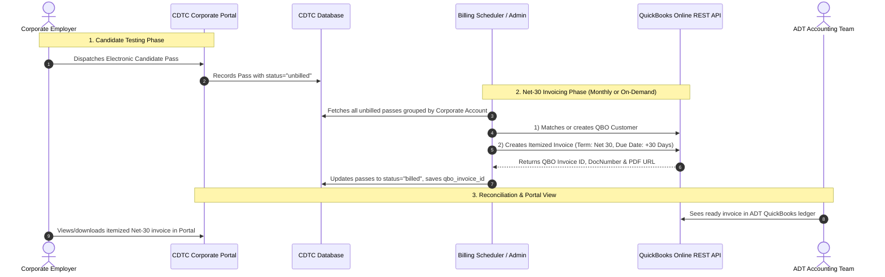

# 📊 QuickBooks Online (QBO) Net-30 Accounting Automation Plan
**Project:** Certified Drug Test Centers (CDTC) & Accredited Drug Testing (ADT)  
**Target:** Automated Net-30 Invoicing & Corporate Portal Accounting Sync  
**Integration Type:** QuickBooks Online (Cloud REST API v3 via OAuth 2.0)  
**Timeline:** 1 to 2 Weeks (40 – 50 Total Hours)

---

## 1. Executive Summary & Objective

Currently, corporate accounts order and dispatch drug testing passes through the platform, but ADT's accounting team must manually aggregate candidate tests, look up pricing, and manually create invoices inside QuickBooks.

This implementation will **fully automate the Net-30 corporate accounting pipeline**:
1. **Passive Tracking:** Every candidate pass dispatched in the Corporate Portal is automatically tracked as an unbilled testing ledger item.
2. **Automated Monthly Invoicing (Net 30):** On the scheduled billing date (e.g., 1st of every month), the system batches all unbilled tests for each corporate employer and automatically generates **one consolidated, itemized Net-30 Invoice** inside ADT's QuickBooks Online.
3. **On-Demand Admin Generation:** Super Admins can click a **"Generate Net-30 Invoice"** button at any time to invoice a specific company for custom date ranges.
4. **Itemized Audit Trail:** Every QuickBooks invoice line lists candidate details: *Candidate Name, Pass/Reg #, Test Panel Name, Facility Name, and Fee*.
5. **Two-Way Visibility:** Super Admins and Corporate Employers can view generated invoice numbers, due dates, PDF downloads, and payment statuses directly within their portals.

---

## 2. Architecture & Data Flow



---

## 3. Database Schema Updates

We will introduce targeted migrations to track accounting records without touching legacy data:

### 1. `quickbooks_tokens`
Stores secure OAuth 2.0 authorization tokens for the ADT QuickBooks Online company file:
```sql
CREATE TABLE quickbooks_tokens (
    id BIGINT UNSIGNED AUTO_INCREMENT PRIMARY KEY,
    realm_id VARCHAR(64) NOT NULL, -- Intuit Company ID
    access_token TEXT NOT NULL,
    refresh_token TEXT NOT NULL,
    access_token_expires_at TIMESTAMP NOT NULL,
    refresh_token_expires_at TIMESTAMP NOT NULL,
    environment ENUM('sandbox', 'production') DEFAULT 'production',
    created_at TIMESTAMP NULL,
    updated_at TIMESTAMP NULL
);
```

### 2. Update `corporate_accounts`
Adds QuickBooks customer linkage and terms:
- `qbo_customer_id` (VARCHAR(64), nullable)
- `qbo_sync_status` (ENUM('unlinked', 'synced', 'error') DEFAULT 'unlinked')
- `payment_terms` (VARCHAR(32) DEFAULT 'Net 30')
- `billing_email` (VARCHAR(255), nullable)

### 3. Update `corporate_passes` (Candidate Testing Ledger)
Tracks billing status for every dispatched pass:
- `billing_status` (ENUM('unbilled', 'billed', 'waived', 'refunded') DEFAULT 'unbilled')
- `quickbooks_invoice_id` (BIGINT UNSIGNED, nullable)
- `billed_at` (TIMESTAMP, nullable)

### 4. `quickbooks_invoices`
Local mirror of all invoices created in QuickBooks:
```sql
CREATE TABLE quickbooks_invoices (
    id BIGINT UNSIGNED AUTO_INCREMENT PRIMARY KEY,
    corporate_account_id BIGINT UNSIGNED NOT NULL,
    qbo_invoice_id VARCHAR(64) NOT NULL,
    qbo_doc_number VARCHAR(64) NOT NULL, -- e.g., INV-10482
    billing_period_start DATE NOT NULL,
    billing_period_end DATE NOT NULL,
    subtotal DECIMAL(10,2) NOT NULL,
    total_amount DECIMAL(10,2) NOT NULL,
    terms VARCHAR(32) DEFAULT 'Net 30',
    invoice_date DATE NOT NULL,
    due_date DATE NOT NULL,
    status ENUM('draft', 'sent', 'paid', 'overdue', 'void') DEFAULT 'sent',
    pdf_url VARCHAR(500) NULL,
    raw_response JSON NULL,
    created_at TIMESTAMP NULL,
    updated_at TIMESTAMP NULL,
    FOREIGN KEY (corporate_account_id) REFERENCES corporate_accounts(id) ON DELETE CASCADE
);
```

### 5. `quickbooks_sync_logs`
Audit log recording every API sync attempt, payload, response code, and error trace for instant troubleshooting.

---

## 4. Module Breakdown

### Module 1: OAuth 2.0 Authentication & Connection Manager
- **SDK:** `quickbooks/v3-php-sdk`
- **Admin UI:** Located under Super Admin Settings (`/admin/settings` -> QuickBooks tab):
  - **"Connect to QuickBooks"** button initiating the Intuit OAuth 2.0 consent flow.
  - Connection status badge showing Company Name, Realm ID, and token expiration.
  - Automated background token refresh prior to each API request (access tokens expire every 60 minutes; refresh tokens auto-rotate).
  - Environment switch between **Sandbox** (for testing) and **Production**.

### Module 2: Customer & Service Item Mapping
- **Customer Auto-Creation:**
  - Before an invoice is generated, the system queries QuickBooks: `SELECT * FROM Customer WHERE DisplayName = '...'`
  - If the Corporate Account does not exist in QBO, it automatically creates the Customer record with Billing Address, Primary Contact, Email, and Phone.
- **Service Item Linking:**
  - Standardizes drug testing products (e.g., *5-Panel Urine*, *10-Panel DOT*, *Hair Follicle 5-Panel*) to map to ADT's QuickBooks Income Accounts/Items.

### Module 3: Net-30 Invoice Aggregation Engine
- **Command:** `php artisan qbo:generate-net30-invoices` (runs via Laravel Task Scheduler on the 1st of each month at 00:00).
- **Invoice Structure:**
  - **Header:** Customer Ref, Transaction Date, Terms (`Net 30`), Due Date (`+30 days`), BillEmail.
  - **Itemized Lines:** One line item per candidate pass:
    ```text
    Description: Candidate: John Doe | Pass: CDTC-PASS-8819 | Collection Site: Quest Diagnostics #4912 (Tampa, FL) | Date: 10/24/2026
    Qty: 1
    Rate: $89.00
    ItemRef: Drug Screening Service
    ```
- **Atomicity:** All passes included in the invoice are tagged with the returned `qbo_invoice_id` in a database transaction so no test can ever be double-billed.

### Module 4: Super Admin Control & Review Dashboard
- **Admin Invoices Screen (`/admin/quickbooks/invoices`):**
  - View all generated Net-30 invoices with live status (Draft, Sent, Paid, Overdue).
  - **"Bill Now / Generate Invoice" Modal:** Select any corporate client and custom date range to immediately generate an invoice on demand.
  - Direct links to **View PDF** and **Open in QuickBooks Online**.
  - **Resync / Retry Action** for any failed transmissions.

### Module 5: Corporate Portal Billing Section
- **Employer Portal View (`/employers/portal/billing`):**
  - Invoices list showing Billing Month, Total Tests, Amount, Due Date, and Status (Pending / Paid).
  - One-click **Download PDF Invoice** button.

---

## 5. Implementation Roadmap (2-Week Schedule)

| Sprint Day | Milestone | Tasks & Deliverables |
|---|---|---|
| **Day 1 – 2** | **App Setup & OAuth 2.0** | • Install `quickbooks/v3-php-sdk`<br>• Create migrations for tokens, logs, and billing fields<br>• Implement `QuickBooksAuthService` with OAuth 2.0 handshake and token auto-refresh |
| **Day 3 – 4** | **Customer & Catalog Mapping** | • Implement `QuickBooksCustomerService` (Lookup & Auto-create Customers)<br>• Implement `QuickBooksItemService` (Map drug test panels to QBO Items)<br>• Add Admin settings tab for QBO credentials |
| **Day 5 – 7** | **Net-30 Invoice Engine** | • Implement `QuickBooksInvoiceService` with line-item candidate formatting<br>• Calculate Net-30 terms and due dates<br>• Build automated scheduler command `qbo:generate-net30-invoices`<br>• Implement batching and transaction-safe pass status updates |
| **Day 8 – 9** | **UI & Admin Controls** | • Build Admin Net-30 Invoices dashboard (`/admin/quickbooks`)<br>• Add manual "Generate Invoice" trigger modal with date range filters<br>• Build Corporate Employer Portal billing view with PDF download links |
| **Day 10 – 11** | **Testing & Hardening** | • Run end-to-end tests in Intuit Developer Sandbox<br>• Test error scenarios (expired token, network timeout, missing customer)<br>• Validate exponential backoff retry queue |
| **Day 12** | **Production Cutover** | • Deploy to production server with PHP 8.2<br>• Connect ADT live QuickBooks Online company<br>• Perform smoke test with first live test account |

---

## 6. Information Needed from ADT / Client

To begin configuration, ADT will need to provide:
1. **Intuit Developer Credentials:**
   - Client ID & Client Secret from their existing Intuit Developer App.
2. **Chart of Accounts Preference:**
   - The name or ID of the QuickBooks Income Account they want drug testing service charges credited to (e.g., *"4000 - Drug Testing Services"*).
3. **Billing Cutoff Date:**
   - Confirmation of whether the billing cycle is the 1st of every month (covering the previous calendar month) or a custom day (e.g. 15th or every 30 days).

---

## 7. Deliverables & Value to ADT

- **Zero Manual Data Entry:** Eliminates hours spent each month manually cross-referencing candidate tests and typing invoices into QuickBooks.
- **Accurate Invoicing:** No missed candidate tests or pricing discrepancies.
- **Full Traceability:** Every line on every QuickBooks invoice links directly to the specific candidate pass and collection facility.
- **Client Transparency:** Corporate clients can view their Net-30 billing status and download invoice copies directly from their portal.
